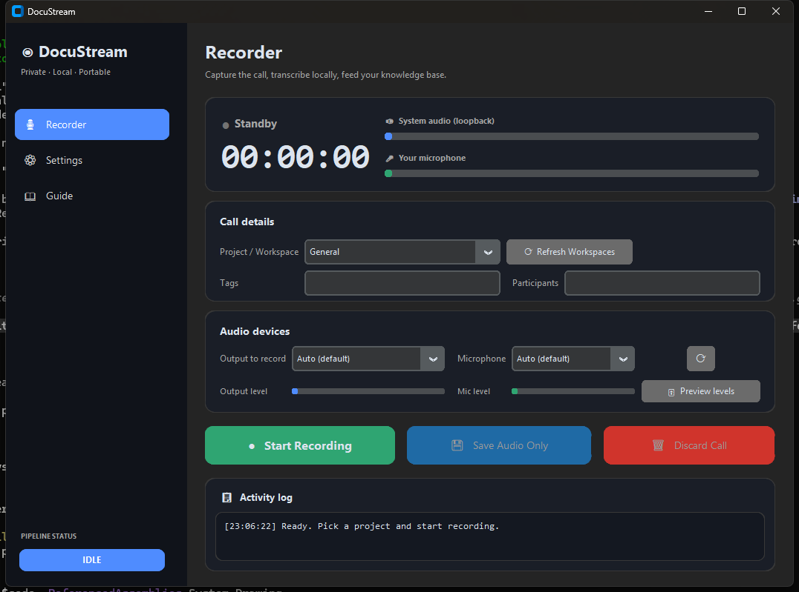
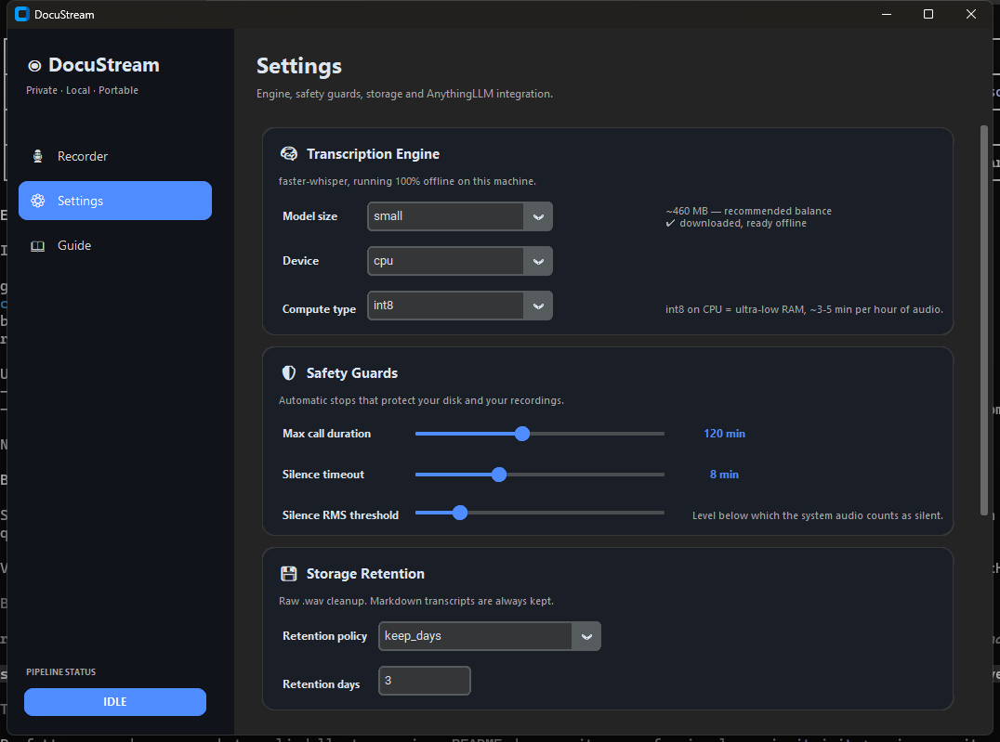
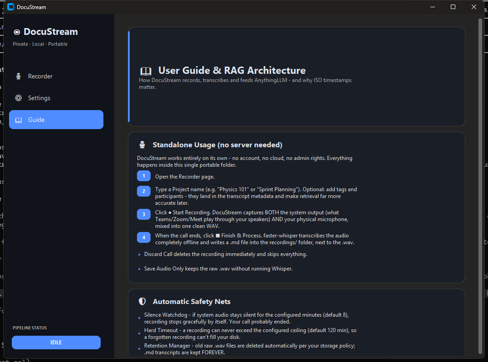

<div align="center">

# 🎙 DocuStream

### Private meeting recorder, local transcriber & AnythingLLM ingestion bridge

**Record any call. Transcribe it offline. Feed your local RAG. Zero cloud, zero admin rights, zero footprint.**

[](https://www.microsoft.com/windows)
[](https://www.python.org)
[](LICENSE)
[]()
[]()

[Features](#-features) • [Quickstart](#-quickstart) • [Usage](#-usage-guide) • [AnythingLLM RAG](#-anythingllm--chronological-rag) • [Configuration](#%EF%B8%8F-configuration) • [FAQ](#-faq) • [Troubleshooting](#-troubleshooting)

</div>

---

## 🧭 What is DocuStream?

DocuStream is a **100% private Windows desktop companion** that turns any meeting or lecture into a searchable, time-anchored knowledge base:

1. **🎧 Records everything you hear + everything you say — separately.** It captures the WASAPI *loopback* (what Teams, Zoom, Google Meet, or any app plays through your speakers) **and** your physical microphone into one **24 kHz, 16-bit stereo WAV**. Left/channel 0 is **Tu** (microphone); right/channel 1 is **Teams / Interlocutori** (loopback). No meeting-app integration needed: *if you can hear it, DocuStream can record it.*
2. **🧠 Transcribes 100% locally with speaker separation.** One shared [faster-whisper](https://github.com/SYSTRAN/faster-whisper) model (`tiny` → `medium`, CPU `int8` or GPU) transcribes the two channels independently, then merges their segments chronologically. No cloud speech API, no account, no per-minute fees. Your conversations never leave your machine.
3. **📚 Feeds date-aware AnythingLLM automatically.** Every transcript ships with strict ISO 8601 metadata, English/Italian date labels, and repeated date/project anchors that survive downstream chunking. Upload is followed immediately by Workspace embedding, and the recommended chronological retrieval settings are applied automatically.
4. **📦 Runs from a single folder.** Python 3.11 embedded, no installer, no registry writes, no admin rights. Uninstall = delete the folder.

---

## 📸 Screenshots

<div align="center">

| 🎙 Recorder dashboard | ⚙ Settings | 📖 In-app Guide |
|:---:|:---:|:---:|
|  |  |  |
| Live timer, dual audio meters, device pickers with level preview, one-click pipeline | Whisper engine, safety guards, retention, AnythingLLM bridge | Standalone usage, AnythingLLM pairing, Chronological RAG explained |

</div>

---

## ✨ Features

| Area | Details |
|---|---|
| **True stereo dual capture** | 24 kHz / 16-bit / 2-channel PCM: left = microphone (**Tu**), right = WASAPI loopback (**Teams / Interlocutori**); no mono mixdown, thread-safe ring buffers |
| **Device control** | Pick *which* output and *which* microphone to capture; live **VU level preview** lets you verify signal *before* recording |
| **Automatic silence watchdog** | Gracefully stops after N minutes of silent right-channel loopback audio (default 8) |
| **Hard timeout guard** | A recording can never exceed the configured ceiling (default 120 min) — protects your disk from a forgotten recording |
| **Local stereo transcription** | Two independent faster-whisper passes share one loaded model; chronological speaker merging; auto-fallback from CUDA to CPU if the GPU runtime is missing |
| **Domain vocabulary biasing** | Persistent `initial_prompt` editor, live word/character counter, >150-word warning, and a PDF extraction meta-prompt clipboard helper |
| **Date-aware chunk metadata** | Strict `published` / `DATE_ISO` values (`YYYY-MM-DDTHH:MM:SS`), English + Italian `DATE_HUMAN`, and repeated `[YYYY-MM-DD | … | Project: …]` anchors every ≤15 utterances or ~300 words |
| **AnythingLLM bridge** | Ping / workspace discovery / document upload / immediate `update-embeddings`; automatic and on-button RAG tuning (`topN=12`, `similarityThreshold=0.25`, chronological system prompt) — fully fail-soft |
| **Retention manager** | Raw `.wav` cleanup per policy (today / N days / after transcribe / forever); Markdown transcripts kept forever |
| **Modern UI** | Dark CustomTkinter shell with sidebar, status pill, toast notifications, animated meters, styled in-app guide |
| **Portable runtime** | `bootstrap_portable.bat` downloads the official Python 3.11 embeddable package + grafts Tkinter + installs deps — all inside the folder |

---

## 🏗 Architecture

```
 +------------------------- WINDOWS DESKTOP -------------------------+
 |                                                                   |
 |  Your voice ──▶ WASAPI Mic ──▶ ring buffer ──▶ LEFT  (Tu)         |
 |  Teams / Zoom / Meet ─▶ WASAPI Loopback ─▶ RIGHT (Interlocutori)  |
 |                                                      ▼            |
 |                        +--------------------- audio_engine.py     |
 |                        |   2-channel, 16-bit, 24 kHz stereo WAV   |
 |                        ▼                                          |
 |                transcription_engine.py                            |
 |                  Split L/R → resample 16 kHz → shared Whisper     |
 |                  Merge by start → ISO + repeated date anchors     |
 |                        ▼                                          |
 |                anythingllm_client.py                              |
 |                  POST /workspace/{slug}/update (RAG tuning)       |
 |                  POST /document/upload                            |
 |                  POST /workspace/{slug}/update-embeddings         |
 |                        ▼  (HTTP localhost, optional)              |
 |                AnythingLLM Desktop ──▶ Workspace ──▶ LanceDB      |
 |                        ▼                                          |
 |                Chronological RAG chat (any local LLM)             |
 +-------------------------------------------------------------------+
```

---

## 🚀 Quickstart

### Portable mode (recommended — zero admin, zero installs)

```powershell
git clone <this-repo> DocuStream
cd DocuStream
.\bootstrap_portable.bat   # ONE-TIME: downloads embedded Python 3.11 (~5 min)
.\run.bat                  # launch - that's it
```

The bootstrap script downloads the official Python 3.11 embeddable package into `runtime/`, grafts in the missing Tcl/Tk payload, enables pip, and installs dependencies — **everything stays inside the DocuStream folder**.

### Standard mode (you have Python 3.11+ already)

```powershell
pip install customtkinter pyaudiowpatch numpy faster-whisper requests
python app.py
```

> **First transcription note:** the first time you transcribe, faster-whisper downloads the selected model once (`small` ≈ 460 MB) into the HuggingFace cache. After that, everything works **offline forever**.

---

## 🎮 Usage guide

### 1. Recorder page — your mission control

**Before recording**
- **Project / Workspace**: name the call (e.g. `Sprint Planning`). If AnythingLLM is configured, click **⟳ Refresh Workspaces** and pick the target workspace here.
- **Tags** and **Participants**: optional, but they land in the transcript metadata and seriously improve retrieval later.
- **Audio devices**: pick the *output* to record (loopback) and the *microphone*. Defaults are your Windows defaults — usually right. Click **🎚 Preview levels**, play some audio and talk: the **Output level** / **Mic level** bars dance if everything is wired correctly.

**During the call**
- **● Start Recording** → the REC dot pulses, the timer runs, and two animated meters show live loopback + mic signal. The WAV keeps them separate: **left = Tu**, **right = Teams / Interlocutori**.
- Clicking does nothing for the first ~10s on a *cold* system? That's the audio drivers waking up — the button shows `⏳ Starting…`. Normal, once per boot.

**When the call ends** — you have three honest choices:
- **■ Finish & Process** → save the stereo WAV, transcribe both channels locally with one shared Whisper model, merge the labeled segments by start time, and (if enabled) optimize + upload + immediately embed into AnythingLLM. Watch the sidebar pill: `TRANSCRIBING` → `INGESTING` → `DONE`. Toast notifications confirm every step.
- **💾 Save Audio Only** → keep the WAV, skip Whisper entirely.
- **🗑 Discard Call** → delete the audio immediately. No transcript, no trace.

**Automatic safety nets** (configurable in Settings):
- **Silence Watchdog** — call ended but you forgot? It stops itself after N minutes of silent system audio.
- **Hard Timeout** — recording can never run past the ceiling.
- **Retention Manager** — old WAVs deleted per policy; **`.md` transcripts are NEVER deleted**.

### 2. The transcript format (why it's RAG-gold)

```markdown
---
TITLE: "Meeting Transcript - Project Alpha"
published: 2026-11-13T14:32:10
DATE_ISO: 2026-11-13T14:32:10
DATE_HUMAN: "Friday 13 November 2026 / Venerdì 13 Novembre 2026"
PROJECT: "Project Alpha"
DURATION_MIN: 47.5
ENGINE: "faster-whisper-small"
SOURCE: DocuStream WASAPI Stereo Dual Capture
LANGUAGE: "en"
PARTICIPANTS: "Alice, Bob, Carol"
TAGS: "budget, q4"
---

[2026-11-13 | Venerdì 13 Novembre 2026 | Project: Project Alpha]

[04:10 - 04:35] Teams / Interlocutori: The original deadline was March 1st.
[04:36 - 04:48] Tu: Decision changed — the deadline moves to April 15th.
```

Both `published` and `DATE_ISO` always use locale-independent `YYYY-MM-DDTHH:MM:SS`, preventing AnythingLLM/JavaScript `Invalid date` errors caused by Windows `DD/MM/YYYY` formats. `DATE_HUMAN` is generated from fixed English/Italian calendars, not the Windows display locale.

Segments are sorted by `start` and labeled **Tu** (left microphone) or **Teams / Interlocutori** (right loopback). Timestamps use `[MM:SS - MM:SS]`; minutes can exceed 59. Temporal anchors repeat every logical block of at most 15 utterances or approximately 300 words, so later AnythingLLM/LanceDB vector chunks retain the exact meeting date and project after the top YAML header is split away.

### 3. Whisper domain vocabulary (`initial_prompt`)

In **Settings → Whisper Domain Vocabulary**, use **Whisper Initial Prompt (Domain Vocabulary & Acronyms)** for exact project names, product names, technical terms, acronyms, and mixed Italian/English terminology. The saved prompt is passed to **both** stereo transcription calls.

- Keep it concise: the live counter warns above **150 words** because Whisper's prompt context is approximately **224 tokens**.
- Prefer a compact comma-separated vocabulary list and at most a couple of short example phrases over long prose.
- Click **Copy PDF Extraction Prompt**, then paste that meta-prompt into an LLM where you have attached your project PDFs. It asks the LLM to return a concise domain prompt. DocuStream itself does **not** read or upload those PDFs.
- Click **Save Settings** before recording/transcribing. An empty prompt disables biasing.

---

## 🔗 AnythingLLM & Chronological RAG

DocuStream is a bridge: it pushes transcripts into [AnythingLLM](https://anythingllm.com) so your *local* LLM can answer questions like *"what did we decide about the deadline (the last time we discussed it)?"*

### Setup (5 minutes)

1. Install **AnythingLLM Desktop** (local, free).
2. In AnythingLLM: `Settings → Tools → Developer API` → enable and **copy the API key**.
3. Create one **Workspace** per project (e.g. `Project-Alpha`).
4. In DocuStream **Settings → AnythingLLM Integration**:
   - Base URL: `http://localhost:3001/api/v1`
   - API Key: paste it
   - Enable **Auto-upload after transcription**
   - Click **⚡ Test Connection** → you want `● ONLINE`
5. On the Recorder page: **⟳ Refresh Workspaces**, pick the workspace. Return to Settings and click **🧭 Optimize Workspace RAG Settings** to configure that selected workspace immediately. Auto-upload also applies the same settings on every ingestion, so this button is mainly for existing workspaces or manual verification.
6. Record as usual.

From then on, **Finish & Process** = record → stereo transcribe → RAG optimize → upload → immediately embed, one click. The exact `custom-documents/...` location returned by `/document/upload` is passed unchanged to `/workspace/{slug}/update-embeddings`. If AnythingLLM is offline, nothing is lost — the `.md` stays in `recordings/` and you get a clear warning.

### Why repeated ISO timestamps matter (Chronological RAG)

Pure semantic search does not understand that *November 13* is a filter. It can also retrieve *"the deadline is March 1st"* and *"deadline moved to April 15th"* together, then blend them into one wrong answer. DocuStream addresses this at both the document and Workspace layers:

- **Every logical block carries its own anchor:** `[YYYY-MM-DD | Venerdì 13 Novembre 2026 | Project: …]`. This is essential because AnythingLLM typically splits long transcripts into ~400–500-word chunks, and chunks after the first do not contain YAML frontmatter.
- **Retrieval is broad enough for chronology:** `POST /v1/workspace/{slug}/update` sets `topN` to **12** and `similarityThreshold` to **0.25**, allowing multi-date and full-meeting questions to retrieve enough context without manually pinning a document.
- **The Workspace system prompt resolves time explicitly:** exact-date questions filter by the embedded `YYYY-MM-DD`; trends and ranges aggregate all relevant dates in order; contradictions prefer the most recent timestamp while retaining the earlier history.

Ask naturally, for example: *"What happened on 2026-11-13?"*, *"Summarize decisions from 2026-11-01 through 2026-11-15 by date"*, or *"What is the latest deadline, and when did it change?"* ISO dates in questions are the least ambiguous, especially across Windows locales.

### Do I need a Vision model for this?

**No.** Transcripts are plain text — even a tiny 1.5B/3B local LLM summarizes them nicely. Vision models (e.g. `llama3.2-vision`) matter only if you feed *images* (diagrams, screenshots) into the chat. DocuStream never produces images.

---

## ⚙️ Configuration

`config.json` is created from `config.default.json` on first run; **Save Settings** in the app writes to it. (Never commit `config.json` — it may contain your API key.)

| Key | Default | Meaning |
|---|---|---|
| `whisper_model` | `small` | `tiny` (~75 MB) / `base` (~145 MB) / `small` (~460 MB) / `medium` (~1.5 GB) |
| `whisper_device` | `cpu` | `cpu` everywhere · `cuda` = NVIDIA GPU (falls back to CPU automatically if CUDA libs are missing) |
| `whisper_compute_type` | `int8` | `int8` = ultra-low RAM on CPU (~3–5 min per channel-hour) |
| `beam_size` | `5` | Whisper decoding beam |
| `initial_prompt` | `""` | Global domain vocabulary/acronym biasing prompt sent to both stereo channels; ≤150 words recommended |
| `max_call_duration_min` | `120` | Hard timeout guard (slider 30–240) |
| `silence_timeout_min` | `8` | Silence watchdog patience (slider 2–20) |
| `silence_rms_threshold` | `120` | RMS level considered "silent" |
| `retention_mode` | `keep_days` | `keep_today` / `keep_days` / `delete_after_transcribe` / `keep_forever` |
| `retention_days` | `3` | Days to keep raw `.wav` files |
| `audio.loopback` / `audio.microphone` | `""` (auto) | Remembered device picker choices |
| `anythingllm.base_url` | `http://localhost:3001/api/v1` | AnythingLLM API root |
| `anythingllm.api_key` | `""` | Developer API key |
| `anythingllm.auto_upload` | `false` | Push transcripts automatically after transcribing |

---

## 🧰 Troubleshooting

| Symptom | Cause | Fix |
|---|---|---|
| `Could not open ... [Errno -9997] Invalid sample rate` on **every** device | The Windows audio graph (`audiodg.exe`) is wedged | Admin PowerShell: `Restart-Service -Force AudioEndpointBuilder; Restart-Service -Force Audiosrv` — or reboot |
| First click on Start takes ~10 s | Virtual-mixer audio drivers waking up (SteelSeries/Sonic Studio, Nahimic, etc.) | Normal after boot; shows `⏳ Starting…` once |
| `cublas64_12.dll is not found` | `cuda` selected but no CUDA 12 runtime installed | Nothing to do: DocuStream falls back to CPU/int8 automatically (see log). Pick `cpu` in Settings to skip the probe |
| Transcription seems stuck the first time | Model `small` (~460 MB) downloading once | Watch the Activity log; afterwards it's offline & fast |
| No system-audio signal in Preview | Windows volume muted / wrong output selected | Unmute, or pick the right output in **Audio devices** |
| Model cache location | faster-whisper choice, not ours | `C:\Users\<you>\.cache\huggingface\hub` |

---

## ❓ FAQ

**Does anything go to the cloud?**
No. Capture, Whisper, and Markdown generation are 100% local. The only network call is the optional `localhost` POST to your own AnythingLLM. Block DocuStream in your firewall entirely and standalone mode doesn't change.

**Is it safe on a locked-down company laptop?**
That's the design target: no admin rights, no installer, no drivers, no registry, no `%APPDATA%` writes. Everything lives inside its folder. An unsigned heuristic scanner may flag the Python runtime once — whitelist the folder or use your own Python runtime.

**Which meeting apps are supported?**
All of them. DocuStream records what your **sound card plays** plus what your **microphone hears** — Teams, Zoom, Meet, Discord, browser lectures, anything.

**Why 24 kHz stereo, and how large are files?**
Speech lives under ~8 kHz. The recorder stores two uncompressed 24 kHz / 16-bit channels so speaker identity survives; transcription resamples each channel to Whisper's required 16 kHz array-input rate. A one-hour stereo recording is approximately **346 MB (330 MiB)**. Use the Retention Manager if raw WAV storage is a concern; Markdown transcripts are always kept.

**Recording laws?**
Vary by jurisdiction (one-party vs all-party consent). DocuStream is a tool — you are responsible for complying with the law and your organization's policies.

---

## 📁 Project structure

```
DocuStream/
├── app.py                    # GUI — sidebar shell, recorder, settings, guide
├── audio_engine.py           # stereo WASAPI capture, watchdogs, level monitor
├── transcription_engine.py   # stereo Whisper, anchored ISO Markdown, retention
├── anythingllm_client.py     # AnythingLLM RAG tuning + upload + immediate embed
├── config_manager.py         # atomic JSON config (never corrupts on crash)
├── config.default.json       # settings template
├── bootstrap_portable.bat    # zero-admin portable runtime installer
├── run.bat                   # one-click launcher
├── docs/screenshots/         # README images
├── recordings/               # output (gitignored)
├── runtime/                  # embedded Python (created by bootstrap; gitignored)
├── LICENSE                   # MIT
└── README.md
```

## 🛠 Tech stack

`customtkinter` (UI) · `pyaudiowpatch` (WASAPI loopback) · `numpy` (DSP) · `faster-whisper` / CTranslate2 (speech-to-text) · `requests` (AnythingLLM API) · Python 3.11 embeddable (portable runtime)

## 🤝 Contributing

Issues and PRs are welcome — especially: audio devices with exotic drivers, Whisper large-model tuning, Linux/macOS capture backends, AnythingLLM flow improvements.

## 📄 License

[MIT](LICENSE) — free for personal and commercial use.
